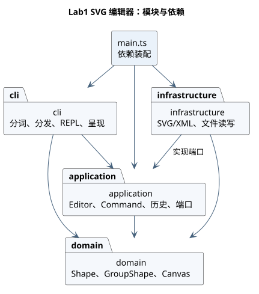

# Lab1 Phase 1 设计与开发记录

## 架构方案

### 模块划分（实现前方案）

| 目录 | 职责 |
| --- | --- |
| `src/domain/` | Shape/Geometry 封装图形属性及几何行为；GroupShape 为组合节点；Canvas 封装结构编辑 |
| `src/application/` | Editor 管理当前文档、路径和文档类用例；CommandHistory 统一调度；commands/ 存放十项编辑命令；ports/ 声明存储和编解码接口 |
| `src/cli/` | Tokenizer/ArgumentList 处理引号及参数；CommandDispatcher 分发；ShapePresenter 显示；Cli/CliSession 承接 REPL 与统一错误输出 |
| `src/infrastructure/` | SvgCodec/SvgTransform 封装 XML 与简单变换规范化；NodeFileStore 隔离本地文件 IO |
| `src/main.ts` | 装配依赖，不承载业务规则 |
| `tests/` | 领域、用例、SVG、CLI 与架构验收 |
| `scripts/` | TypeScript 测试启动工具，不参与业务依赖 |
| `examples/`、`doc/`、`.github/` | 可回放示例、提交文档及持续集成配置 |



[可编辑的 PlantUML 源码](architecture.puml)。箭头指向被依赖模块；main 负责组装，infrastructure 实现 application 声明的端口。

### 设计模式的选择

- Command：每项编辑对应具体命令；命令只调用 Canvas 接收者的操作。历史统一调度，单条命令形成一个撤销单元。
- Composite：Shape 为统一抽象，六种具体类型各自处理几何，GroupShape 递归操作子节点。
- Memento：命令持有执行前后完整文档快照；先在副本执行，失败不提交。Phase 1 优先可验证的原子性，暂不做增量差量历史。
- 通过依赖注入隔离 FileStore、DocumentCodec，CLI 与领域不直接读写文件。
- **按名字分发的两处待重构点**：CommandDispatcher 的命令表与 ShapeFactory 的内置类型表。后续阶段有实际插件需求再改为注册入口；本阶段不提前实现 `box` 插件。

Command 的参与者与代码对应如下：

| 参与者 | 本项目实现 | 职责 |
| --- | --- | --- |
| Command | `EditCommand` | 在副本执行并持有执行前后快照，公开 execute/undo/redo |
| ConcreteCommand | `CreateCommand` 至 `BackCommand` 等十个类 | 保存请求参数，委托接收者 |
| Receiver | `Canvas` 及 Shape 层次 | 完成几何、属性与树编辑业务 |
| Invoker | `CommandHistory`，由 Editor 调用 | 管理历史、redo 分支和 IO 屏障 |
| Client | `CommandDispatcher`，由 main 装配 | 把用户意图构造成具体命令 |

每次成功编辑才替换当前文档并压栈。任何验证或运算失败都丢弃副本，因此不会出现“前两个子图形已缩放，第三个溢出后留下半成品”。重做恢复执行后快照，避免重新解析命令或重新生成 ID。

### 依赖方向规则

| 模块 | 允许依赖 | 理由 |
| --- | --- | --- |
| domain | 同模块 | 领域规则独立于 UI、XML 和文件系统 |
| application | domain、同模块端口 | 组织用例，不绑定 IO 实现 |
| cli | application、domain、Node 输入输出 | 把文本转为请求及显示，不做结构编辑 |
| infrastructure | application、domain、Node、XML 库 | 实现端口并转换外部格式 |
| main | 上述全部 | 唯一业务装配入口 |

测试与启动工具可依赖被测模块或 Node 工具接口。底层禁止反向依赖 UI；XML 库只允许出现在 infrastructure；业务内层禁止引入外部包。违反规则的依赖均视为待处理项，不能因测试通过而忽略。

### 变化点假设

1. 新图形：继承 Shape，修改 ShapeFactory，并更新 CLI 帮助与相应测试。类型表和帮助 schema 尚未统一，这一扩展成本如实保留到后续插件阶段；本阶段不设计动态加载。
2. GUI/agent 入口：复用 Editor、命令和领域模型，新增入口适配层。
3. 存储位置或 SVG 解析库：替换端口实现，不改业务层。
4. 大文档历史：完整快照时间/空间均随元素数增长；有性能证据后替换为局部 memento。
5. 命令语法与显示排版：限制在 cli；不让领域对象解析整行文本。

### 明确的语义决策与实现边界

- ID 全树唯一、大小写敏感；不接受空 ID 或含空白的 ID。SVG 读入先预留全部显式 ID，再以标签加序号补全，警告只在整份读入成功后输出。
- group 按原文档的深度优先顺序收编。原父相同时，新组占据最早被选中元素的位置；跨父级时，新组进入根级，放在最早涉及的根级分支之前。重复选择、祖先与后代同时选择均失败。
- ungroup 仅允许非根级普通 g；子节点在原位置连续提升。addto 移入目标容器末尾；禁止形成环。front 进入同级数组末尾，按 SVG 规则最后绘制；back 进入开头。
- move 是增量。CLI scale 按题意同乘几何坐标与尺寸，text 仅缩放 x/y，不缩放字号；不缩放 stroke-width。对 g 递归，对 g 设置公共样式使用 SVG 自然继承，显式子样式优先。重新归组后，继承样式随新父级变化。
- init/read/save/修改 canvas 成功后清空历史并设屏障；tree/show/help/canvas 查询不改变历史。失败的编辑或 IO 保留文档、默认路径及 redo。下一条成功编辑解除屏障。
- init 允许省略一个或两个尺寸，分别默认宽 800、高 600；canvas 修改要求同时给宽高。帮助在初始化前可用，方便首次进入使用。画布宽高为正，几何尺寸和笔画宽度非负，所有数值必须有限。
- set 严格遵守教师白名单。save 不主动补写默认 fill/stroke；读写 text 使用 XML 子文本。save 指定路径成功后记为默认路径，init 清除旧路径。所有文件操作均为 UTF-8。
- SVG 支持 rect/circle/ellipse/line/text/g；几何数值接受纯数值或 px，保留 viewBox、根公共样式，以及 font-size/text-anchor 等已列入 Shape 的常见显示属性。缺省几何按 0 处理。
- 对背景示例使用的 `translate(dx,dy) scale(s)`（两项均可单独出现，s 为正等比数值）在读入时规范化坐标，合成嵌套变换；同时按有效缩放保存基本笔画宽度和文本字号。不会在树中保留 transform 字符串。
- 本阶段不是完整 SVG 浏览器：不支持 path、defs/use、tspan、CSS style/class、旋转、矩阵、非等比缩放、外部实体、DTD 等，也不承诺复杂样式与变换组合的无损转换。遇到不支持的元素、属性或变换时报错，保留旧文档；不静默删除未知元素。`box` 返回教师指定的 unknown shape type。
- 快照历史每条编辑保存两份完整文档，空间 O(H×N)，单次编辑至少 O(N)；ID 查找为树遍历。对课程规模优先保证可读性与原子性，有大文档证据后再引入索引、差量历史或深度限制。

## 过程记录

### 迭代 1：规格与测试先行

2026-11-08，读取教师要求与课程简介、Command、Composite、TDD、软件设计原则等课件。先明确职责、依赖及可执行验收标准，再分批实现。用户提供远程仓库 `Jiayang-Xiao/Lab1`，各阶段按真实开发过程提交和推送。

检查要求时识别到：`box` 属下一阶段；根级 g 不得 ungroup；文档类成功执行后设置历史屏障；失败命令不得连带清空 redo。后续测试逐项覆盖。

本记录只描述实际发生的 AI 协作和验证，不把 AI 自查写成学生已经手工评审。

### 迭代 2：领域模型与编辑历史

初始验收先因缺少 Editor/CLI/Codec 而编译失败，确认测试确实指向待实现接口。随后实现六种 Shape、Canvas 接收者、十项编辑命令和文档快照历史。阶段性编译与 7 项领域/用例测试通过，包含中途数值溢出的原子回滚与失败后 redo 保留。

自查时把移动摘要中对 GroupShape 的类型判断移回多态方法 `movementSummary`，避免在接收者里逐类分发。具体命令不承担树操作和文件 IO。

### 迭代 3：SVG 与文件适配器

使用 XML DOM 库而非正则拆 XML；通过 `onError` 拒绝解析器的容错警告。先预扫描并预留全部显式 id，解决“前面的无名 rect 抢走后面 rect1”的碰撞问题。测试覆盖实体转义、中文/emoji、根样式、px、viewBox、重复 id 与非法 XML。阶段共 11 项测试通过。本地写文件先写同目录临时文件，再替换目标。

### 迭代 4：CLI 与教师示例回放

实现所有 19 个命令入口、`svg>` REPL、注释和双引号分词，额外支持 `--script` 文件回放。补充逐项错误约定、非法参数、大小写 id、空文字、Windows 路径与显示命令不入历史的验收，累计 52 项测试通过。真实回放教师版本 A，生成 `examples/flowchart.svg` 并读回，相同树结构显示正常。

### 迭代 5：完整验收与环境修正

补查十项编辑操作的单步 undo/redo、跨父级 group、同级 z-order、白名单、真实文件覆盖/失败写入清理、独立 CLI 子进程和架构依赖，累计 68 项通过。使用本机 Node 18 实际执行 `npm test` 时，发现 Windows 不展开 `*.test.js`，将测试入口改为目录发现，修复后通过。

考虑教师背景示例中的变换，新增 SVG `translate` 后接等比 `scale` 的规范化读入，把变换合成为叶子坐标，并保存缩放后的文本字号与笔画宽度；新增两项测试，累计 70 项通过。旋转和非等比变换无法由本阶段几何模型无损表达，明确拒绝。添加 Windows/Node 18 与 Linux/Node 24 的 CI，并固定依赖版本和官方包地址。

### 迭代 6：用真实 CI 纠正跨版本假设

首轮云端 Windows 通过，Linux/Node 24 在测试入口失败。读取日志后在本机 Node 24 重现：新版本不把显式目录参数递归展开。最终用 TypeScript 的 `scripts/TestRunner.ts` 枚举编译后的测试文件并通过参数数组启动 Node，避免依赖 shell 通配符或 Node 版本特定的目录发现。这个问题来自测试启动环境而非编辑器业务；分别在 Node 18/24 重新验证，再提交修正。

## 一致性自查

1. **模块划分一致**：四个业务模块及 main 均按初始方案实现。后续新增的 SvgTransform 仍属于外部格式适配，不改变依赖方向；增加 scripts 测试工具、examples 示例及 CI 是配套目录，已在上表补记。新增图形时还需更新帮助，这个成本也已从初始简述修订为明确的变化点。
2. **依赖方向未发现违规**：`tests/architecture.test.ts` 使用 TypeScript AST 遍历全部 src 文件，验证模块 import 方向、业务内层无外部包、一类一文件、类名等于文件名、无顶层过程函数、无 switch。该检查随 npm test 执行。
3. **抽样检查**：domain/Canvas 只引用同层 Shape/GroupShape/集合/数值；application/Editor 只引用 domain、历史、命令与自己的端口；infrastructure/SvgCodec 引用领域与 DocumentCodec，不引入 CLI；cli/CommandDispatcher 只构造命令并调 Editor，不读写文件。
4. **保留的待重构项**：内置命令表、类型表及帮助 schema 尚未插件化；完整快照和线性查找未针对大图优化。这些是已公开的阶段选择，不属于隐藏的依赖违规。

## 质量保证手段

通过编译、领域/用例/适配器/CLI 多层测试、真实文件与子进程、人工图像检查以及云端双环境验证建立信心。测试既断言预期结果，也在失败之后检查原状态和 redo，避免只验证“没有抛异常”。

| 测试文件 | 数量 | 核查内容 |
| --- | ---: | --- |
| acceptance.test.ts | 1 | 六种元素、组合、IO 屏障及 SVG 往返完整会话 |
| domain.test.ts | 3 | 组合几何、分组顺序、深拷贝及父引用 |
| history.test.ts | 4 | redo 分支、整组撤销、溢出原子性、IO 屏障 |
| svg.test.ts | 6 | XML 转义/中文、自动 ID、无效 XML、px/viewBox/根样式、简单变换及拒绝范围 |
| cli.test.ts | 40 | 分词、19 个入口相关契约、错误信息、参数与失败不改状态 |
| editing.test.ts | 13 | 十项编辑各自 undo/redo、同级 z-order、跨父级 group、全部 set 几何白名单 |
| filesystem.test.ts | 2 | 文件覆盖/失败清理、默认路径、真实脚本/标准输入/退出码 |
| architecture.test.ts | 1 | 模块依赖及面向对象静态约束 |
| **合计** | **70** | **全部通过，无跳过项** |

运行与复核：

```powershell
npm ci
npm test
npm run demo
git diff --exit-code -- examples/flowchart.svg
git diff --check
```

在本机 Windows 的 Node 18.18.2 与 24.22.1 运行通过。真实交互界面确认 `svg>`、中文输入/树显示；教师版本 A 脚本生成 8 元素的 SVG，保存后读回结构一致，白底渲染人工检查节点、文字与连线正常。教师提供的 other.svg 样例保留在 examples/，可用 `read examples/other.svg` 检查自动 ID 警告。

GitHub Actions 在 Windows/Node 18 与 Linux/Node 24 执行安装、70 项测试、教师示例回放及 SVG 稳定性检查。[已通过的双环境验证](https://github.com/Jiayang-Xiao/Lab1/actions/runs/42458474889)；后续提交由同一工作流持续检查，可从仓库 Actions 查看。

提交材料为源码、依赖锁文件、示例和本 Markdown；不提交 node_modules、dist、临时研究缓存或图表工具。最终版本使用 annotated tag `final` 标记；提交时间与 tag 时间保持真实。
