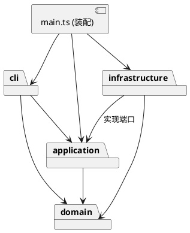

# Lab1 Phase 1 设计与开发记录

## 架构方案

### 模块划分（实现前方案）

| 目录 | 职责 |
| --- | --- |
| `src/domain/` | 图形多态、组合树、几何及属性约束；Canvas 封装结构编辑 |
| `src/application/` | Editor 用例、Command 与历史、文件/编解码端口 |
| `src/cli/` | 引号分词、命令分发、文本呈现与 REPL |
| `src/infrastructure/` | SVG XML 编解码与本地文件存储 |
| `src/main.ts` | 装配依赖，不承载业务规则 |
| `tests/` | 领域、用例、SVG、CLI 与架构验收 |

### 设计模式的选择

- Command：每项编辑对应具体命令；命令只调用 Canvas 接收者的操作。历史统一调度，单条命令形成一个撤销单元。
- Composite：Shape 为统一抽象，六种具体类型各自处理几何，GroupShape 递归操作子节点。
- Memento：命令持有执行前后完整文档快照；先在副本执行，失败不提交。Phase 1 优先可验证的原子性，暂不做增量差量历史。
- 通过依赖注入隔离 FileStore、DocumentCodec，CLI 与领域不直接读写文件。
- **按名字分发的两处待重构点**：CommandDispatcher 的命令表与 ShapeFactory 的内置类型表。后续阶段有实际插件需求再改为注册入口；本阶段不提前实现 `box` 插件。

### 依赖方向规则

domain 不依赖其他业务模块或 Node 文件 IO；application 只依赖 domain 和自己的端口；cli 只依赖 application/domain（REPL 可依赖 Node 流）；infrastructure 依赖 application 的端口及 domain；main 可依赖以上各模块。底层不反向引用 UI，XML 库仅出现在 infrastructure。

### 变化点假设

1. 新图形：继承 Shape，变更集中在具体类型及 ShapeFactory；暂不设计动态插件加载。
2. GUI/agent 入口：复用 Editor、命令和领域模型，新增入口适配层。
3. 存储位置或 SVG 解析库：替换端口实现，不改业务层。
4. 大文档历史：完整快照时间/空间均随元素数增长；有性能证据后替换为局部 memento。
5. 命令语法与显示排版：限制在 cli；不让领域对象解析整行文本。

## 过程记录

### 迭代 1：规格与测试先行

2026-11-08，读取教师要求与课程简介、Command、Composite、TDD、软件设计原则等课件。先明确职责、依赖及可执行验收标准，再分批实现。用户提供远程仓库 `Jiayang-Xiao/Lab1`，并说明截止时间已过，要求先完成作业。

检查要求时识别到：`box` 属下一阶段；根级 g 不得 ungroup；文档类成功执行后设置历史屏障；失败命令不得连带清空 redo。后续测试逐项覆盖。

本记录只描述实际发生的 AI 协作和验证，不把 AI 自查写成学生已经手工评审。

### 迭代 2：领域模型与编辑历史

初始验收先因缺少 Editor/CLI/Codec 而编译失败，确认测试确实指向待实现接口。随后实现六种 Shape、Canvas 接收者、十项编辑命令和文档快照历史。阶段性编译与 7 项领域/用例测试通过，包含中途数值溢出的原子回滚与失败后 redo 保留。

自查时把移动摘要中对 GroupShape 的类型判断移回多态方法 `movementSummary`，避免在接收者里逐类分发。具体命令不承担树操作和文件 IO。

### 迭代 3：SVG 与文件适配器

使用 XML DOM 库而非正则拆 XML；通过 `onError` 拒绝解析器的容错警告。先预扫描并预留全部显式 id，解决“前面的无名 rect 抢走后面 rect1”的碰撞问题。测试覆盖实体转义、中文/emoji、根样式、px、viewBox、重复 id 与非法 XML。阶段共 11 项测试通过。本地写文件先写同目录临时文件，再替换目标。

## 一致性自查

待实现后根据实际目录与依赖检查结果更新。

## 质量保证手段

先建立验收测试，再实现领域与编辑命令、SVG 往返、CLI。完成后运行编译、全量测试、真实脚本回放，并对照要求做覆盖表。最终结果在后续提交中补齐。
